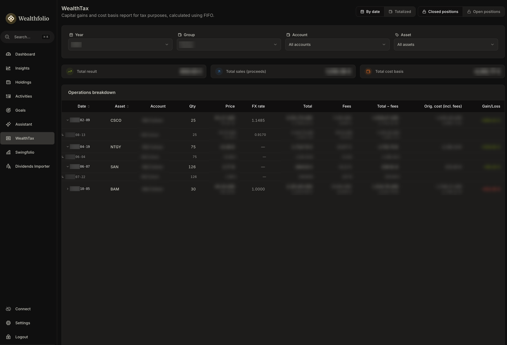

<div align="center">

# WealthTax

**FIFO tax reporting for [Wealthfolio](https://wealthfolio.app)**<br>
**Informe fiscal FIFO para [Wealthfolio](https://wealthfolio.app)**

[](LICENSE)
[](https://github.com/wealthfolio/wealthfolio/tree/main/docs/addons)
[](#how-the-fifo-engine-works)
[](#privacy-and-permissions)
[](#requirements-and-installation)
[](#privacy-and-permissions)

[**English**](#english) · [**Español**](#español)

</div>

---

# English

> Realized gains, cost basis and open lots — computed with **FIFO**, straight
> from your Wealthfolio activity history, without your data ever leaving your
> machine.

WealthTax is an addon for Wealthfolio that turns your buy and sell history into
a clear tax report. Every sale is matched against the oldest purchase lots
first (First-In, First-Out), so you can see exactly **which lots each sale
consumed, at what cost, with which fees and at which exchange rate**.

It understands stock splits, reverse splits and scrip dividends, works across
currencies, and can pool lots at the account-group level.

<p align="center">
  
</p>

## Contents

- [Highlights](#highlights)
- [The three views](#the-three-views)
- [How the FIFO engine works](#how-the-fifo-engine-works)
- [Filters](#filters)
- [Multi-currency](#multi-currency)
- [Privacy and permissions](#privacy-and-permissions)
- [Requirements and installation](#requirements-and-installation)
- [Disclaimer](#disclaimer)
- [Changelog](#changelog)
- [License](#license)

## Highlights

| | |
| --- | --- |
| **Closed positions** | Every sale with gain/loss, the buy lots it consumed, fees and FX rate. |
| **Totalized view** | One row per asset and group, with all sales summed and the date of the last one. |
| **Open positions** | Active lots per asset with quantity, average price, cost basis and accumulated fees. |
| **Splits & scrip dividends** | Retroactive split adjustment; free capital increases dilute existing lots at no extra cost. |
| **Group-level FIFO** | Accounts that share a group share one lot pool, as the tax treatment usually requires. |
| **Multi-currency** | Original currency first, base-currency equivalent underneath. |
| **Bilingual** | Spanish when Wealthfolio is in Spanish, English for any other language — it follows the app live. |
| **Private by design** | Read-only, no network access, no browser storage, nothing leaves your machine. |

## The three views

### Closed positions — by date

The default view: one row per sale. Click the **Date** or **Asset** header to
sort; a third click clears the sort.

Click a row to expand the **buy lots** that the sale consumed:

- purchase date and originating account,
- quantity (with the `×N` split factor when a split applied),
- purchase price, FX rate, total and fees in the original currency,
- the base-currency equivalent beneath each figure.

Columns: *Date · Asset · Account · Qty · Price · FX rate · Total · Fees ·
Total − fees · Original cost (incl. fees) · Gain/Loss*.

The **Account** column shows the account the sale was made from.

### Closed positions — totalized

Switch to **Totalizado** (next to *Por fechas*) for the same layout, collapsed
to **one row per asset and account group**:

- **Last sale** replaces the date: the most recent sale of that asset.
- Quantity, totals, fees, net proceeds, cost and gain are **summed**.
- **Average price** and **average FX rate** are weighted by the amounts sold.
- Groups are never mixed: FIFO lots belong to a group, so the same asset sold
  in two different groups produces two rows.
- Accounts of the same group are added together; accounts of different groups
  never are. That is why this view shows the **Group** instead of the account.
- If one asset was sold in several currencies, amounts fall back to the base
  currency, because original amounts can't be added across currencies.

### Open positions

Active (unsold) lots grouped by asset, expandable to the individual lots.
Columns: *Date · Asset · Account · Qty · Purchase price · FX rate · Original
total · Fees · Cost basis*.

The **Account** column shows the account when all the lots of a position come
from a single one, or **Multiple** when they come from several.

### Summary cards

A compact, single-line summary sits above the table and updates with the
filters:

| Closed positions | Open positions |
| --- | --- |
| Total result (green/red by sign) | Open positions (with active lot count) |
| Total sales (proceeds) | Total cost (incl. fees) |
| Total cost basis | Total fees |

### Built for long tables

The header, filters, summary and the table's column header stay **pinned**;
only the list of values scrolls. Wide tables scroll horizontally inside the
same area.

## How the FIFO engine works

Sales consume the **oldest** purchase lots first. A worked example (fees omitted
for clarity):

| Date | Operation | Quantity | Price |
| --- | --- | ---: | ---: |
| 2024-02-01 | Buy | 10 | 100 |
| 2024-06-01 | Buy | 10 | 120 |
| 2025-03-01 | **Sell** | **15** | **150** |

The sale consumes the whole first lot (10 × 100) and part of the second
(5 × 120):

```
Proceeds   15 × 150            = 2 250
Cost basis 10 × 100 + 5 × 120  = 1 600
Gain                           =   650      → 5 shares remain open at 120
```

Corporate actions are handled automatically:

- **Splits and reverse splits** — quantities and prices of purchases made
  before the split date are adjusted retroactively; the `×N` factor is shown on
  the affected lots, and the *original* pre-split price is preserved for
  display.
- **Scrip dividends / free capital increases** (`TRANSFER_IN`) — existing lots
  are diluted proportionally with **no additional cost**: quantity grows, unit
  cost shrinks, total cost is preserved.
- **Fees** are apportioned to the lots they belong to and carried into the cost
  basis and the net proceeds.
- Only **posted** activities feed the engine.

## Filters

| Filter | Behaviour |
| --- | --- |
| **Year** | The list starts at the first year with any activity in your whole Wealthfolio database and runs up to the current year; it opens on the current year (or choose *All years*). For closed positions it filters by sale year; for open positions, by **purchase** year. |
| **Group** | Shows every account in the group. |
| **Account** | Mutually exclusive with *Group* — choosing one clears the other. |
| **Asset** | Restricts the report to one instrument. |

Good to know:

- If your open positions were bought in earlier years, they won't appear until
  you switch the year to **All years**.
- Filtering by an **account** that belongs to a group still computes FIFO for
  the whole group (so lots are consumed correctly), but *Closed positions* only
  lists sales made **from that account**. If it made no sales in the selected
  year the table is empty even though the group has activity — try *All years*
  or check *Open positions*.
- The **Totalizado** view respects every filter above.

## Multi-currency

Each figure is shown in the **original currency of the transaction**, with the
**base-currency equivalent** underneath whenever the two differ (using the
activity's own FX rate). The currency always goes on the right, separated by a
space: `€` for euros, the ISO code for everything else. Number formatting
follows the interface language — Spanish: `1.234,50 €`, `1.234,50 USD`; any
other language: `1,234.50 €`, `1,234.50 USD`. Thousands separators appear from
four digits upward, and amounts are right-aligned with tabular figures so
columns line up.

## Privacy and permissions

WealthTax is **read-only**: it never creates, modifies or deletes accounts,
activities, holdings or settings. It makes **no network requests** and doesn't
declare the `network` permission, so Wealthfolio's sandbox guarantees that your
data stays on your machine. It also uses no browser storage.

Permissions declared in `manifest.json`:

| Category | Functions | Purpose |
| --- | --- | --- |
| `activities` | `getAll` | Read the full activity history to compute FIFO cost basis and gains |
| `accounts` | `getAll` | Resolve account groups and account names |
| `settings` | `get` | Read the base currency to display converted amounts |
| `ui` | `sidebar.addItem`, `router.add` | Add the menu entry and the report page |

It does **not** request the `portfolio` permission and never reads market
value or unrealized gains — it only works with closed sales and open lots **at
cost**.

## Requirements and installation

- Wealthfolio **3.8 or later** (the addon uses the sandbox localization
  runtime introduced in 3.8). Built and type-checked against SDK **3.11.0**.
- The interface follows Wealthfolio's language: **Spanish** when Wealthfolio is
  set to Spanish, **English** for every other language.

1. Download `wealth-tax-addon.zip` from the
   [latest release](https://github.com/advenacodex/wealth-tax/releases/latest).
2. In Wealthfolio go to **Settings → Add-ons → Installed → Install from File**
   (the `+` icon) and pick the zip.
3. Review the permissions Wealthfolio shows (see
   [Privacy and permissions](#privacy-and-permissions)) and confirm.

The addon activates right after installation and **WealthTax** appears in the
sidebar. To update, download the new zip and install it the same way —
installing with the same `id` replaces the previous version.

WealthTax is also listed in the
[Wealthfolio community addon directory](https://wealthfolio.app/addons/community)
once its listing is published there; the directory only links to this
repository, and the install is always **Install from File**.

## Disclaimer

WealthTax is an informational tool. It is **not tax advice**, and results depend
on the quality and completeness of the data in your Wealthfolio. Check the
figures against your own records and consult a qualified professional before
filing.

## Changelog

See [CHANGELOG.md](CHANGELOG.md) for the full history of changes
([Keep a Changelog](https://keepachangelog.com/en/1.1.0/) format, following
[Semantic Versioning](https://semver.org/)). Spanish version:
[CHANGELOG.es.md](CHANGELOG.es.md).

## License

[MIT](LICENSE) © 2026 advenacodex

[](https://ko-fi.com/advenacodex)

---

# Español

> Plusvalías realizadas, base de coste y lotes abiertos — calculados con
> **FIFO** a partir del historial de operaciones de Wealthfolio, sin que tus
> datos salgan nunca de tu equipo.

WealthTax es un addon de Wealthfolio que convierte tu historial de compras y
ventas en un informe fiscal claro. Cada venta se empareja primero con los lotes
de compra más antiguos (First-In, First-Out), de modo que ves exactamente
**qué lotes consumió, a qué coste, con qué comisiones y a qué tipo de cambio**.

Entiende splits, contrasplits y scrip dividends, funciona entre divisas y puede
agrupar lotes a nivel de grupo de cuentas.

<p align="center">
  
</p>

## Contenido

- [Lo más destacado](#lo-más-destacado)
- [Las tres vistas](#las-tres-vistas)
- [Cómo funciona el motor FIFO](#cómo-funciona-el-motor-fifo)
- [Filtros](#filtros)
- [Multidivisa](#multidivisa)
- [Privacidad y permisos](#privacidad-y-permisos)
- [Requisitos e instalación](#requisitos-e-instalación)
- [Aviso legal](#aviso-legal)
- [Changelog (ES)](#changelog-es)
- [Licencia](#licencia)

## Lo más destacado

| | |
| --- | --- |
| **Posiciones cerradas** | Cada venta con plusvalía/minusvalía, los lotes de compra consumidos, comisiones y tipo de cambio. |
| **Vista totalizada** | Una fila por activo y grupo, con todas las ventas sumadas y la fecha de la última. |
| **Posiciones abiertas** | Lotes activos por activo con cantidad, precio medio, coste base y comisiones acumuladas. |
| **Splits y scrip dividends** | Ajuste retroactivo de splits; las ampliaciones gratuitas diluyen los lotes existentes sin coste adicional. |
| **FIFO por grupo** | Las cuentas que comparten grupo comparten un mismo pool de lotes. |
| **Multidivisa** | Divisa original primero, equivalente en divisa base debajo. |
| **Bilingüe** | Español si Wealthfolio está en español, inglés para cualquier otro idioma — sigue a la app en directo. |
| **Privado por diseño** | Solo lectura, sin acceso a red, sin almacenamiento del navegador, nada sale de tu equipo. |

## Las tres vistas

### Posiciones cerradas — por fechas

La vista por defecto: una fila por venta. Pulsa la cabecera **Fecha** o
**Activo** para ordenar; un tercer clic quita la ordenación.

Pulsa una fila para desplegar los **lotes de compra** que consumió la venta:

- fecha de compra y cuenta de origen,
- cantidad (con el factor `×N` cuando se aplicó un split),
- precio de compra, tipo de cambio, total y comisiones en la divisa original,
- el equivalente en divisa base bajo cada cifra.

Columnas: *Fecha · Activo · Cuenta · Cant. · Precio · Tasa FX · Total ·
Comisiones · Total − com. · Coste orig. (c/com.) · Benef./Pérd.*

La columna **Cuenta** muestra la cuenta desde la que se hizo la venta.

### Posiciones cerradas — totalizado

Cambia a **Totalizado** (junto a *Por fechas*) para ver el mismo formato
reducido a **una fila por activo y grupo de cuentas**:

- **Última venta** sustituye a la fecha: la venta más reciente de ese activo.
- Cantidad, totales, comisiones, neto, coste y beneficio se **suman**.
- El **precio medio** y la **tasa FX media** se ponderan por los importes
  vendidos.
- Los grupos nunca se mezclan: los lotes FIFO pertenecen a un grupo, así que el
  mismo activo vendido en dos grupos distintos da dos filas.
- Las cuentas de un mismo grupo se suman; las de grupos distintos, nunca. Por eso
  esta vista muestra el **Grupo** y no la cuenta.
- Si un activo se vendió en varias divisas, los importes pasan a la divisa
  base, porque los importes originales no se pueden sumar entre divisas.

### Posiciones abiertas

Lotes activos (no vendidos) agrupados por activo, desplegables hasta cada lote.
Columnas: *Fecha · Activo · Cuenta · Cant. · Precio compra · Tasa FX · Total
orig. · Comisiones · Coste base.*

La columna **Cuenta** muestra la cuenta cuando todos los lotes de una posición
vienen de una sola, o **Varias** cuando vienen de varias.

### Tarjetas de resumen

Un resumen compacto de una sola línea sobre la tabla, que se actualiza con los
filtros:

| Posiciones cerradas | Posiciones abiertas |
| --- | --- |
| Resultado total (verde/rojo según signo) | Posiciones abiertas (con nº de lotes activos) |
| Total ventas (ingresos) | Coste total (incl. comisiones) |
| Base de coste total | Comisiones totales |

### Pensado para tablas largas

La cabecera, los filtros, el resumen y la cabecera de columnas de la tabla
permanecen **fijos**; solo se desplaza la lista de valores. Las tablas anchas se
desplazan en horizontal dentro de la misma zona.

## Cómo funciona el motor FIFO

Las ventas consumen primero los lotes de compra **más antiguos**. Un ejemplo
(sin comisiones, para simplificar):

| Fecha | Operación | Cantidad | Precio |
| --- | --- | ---: | ---: |
| 2024-02-01 | Compra | 10 | 100 |
| 2024-06-01 | Compra | 10 | 120 |
| 2025-03-01 | **Venta** | **15** | **150** |

La venta consume el primer lote completo (10 × 100) y parte del segundo
(5 × 120):

```
Ingresos     15 × 150            = 2 250
Base coste   10 × 100 + 5 × 120  = 1 600
Plusvalía                        =   650    → quedan 5 acciones abiertas a 120
```

Las operaciones corporativas se gestionan automáticamente:

- **Splits y contrasplits** — se ajustan retroactivamente cantidades y precios
  de las compras anteriores a la fecha del split; el factor `×N` se muestra en
  los lotes afectados y se conserva el precio *original* previo al split.
- **Scrip dividends / ampliaciones gratuitas** (`TRANSFER_IN`) — los lotes
  existentes se diluyen proporcionalmente **sin coste adicional**: crece la
  cantidad, baja el coste unitario y se conserva el coste total.
- Las **comisiones** se prorratean a los lotes a los que pertenecen y pasan a
  la base de coste y al neto de la venta.
- Solo las operaciones **contabilizadas** (`POSTED`) alimentan el motor.

## Filtros

| Filtro | Comportamiento |
| --- | --- |
| **Año** | La lista empieza en el primer año con alguna actividad en toda tu base de datos de Wealthfolio y llega hasta el año actual; se abre en el año actual (o elige *Todos los años*). En posiciones cerradas filtra por año de venta; en abiertas, por año de **compra**. |
| **Grupo** | Muestra todas las cuentas del grupo. |
| **Cuenta** | Excluyente con *Grupo*: elegir uno limpia el otro. |
| **Activo** | Limita el informe a un instrumento. |

Conviene saber:

- Si tus posiciones abiertas se compraron en años anteriores, no aparecerán
  hasta que cambies el año a **Todos los años**.
- Al filtrar por una **cuenta** que pertenece a un grupo, el FIFO se sigue
  calculando para todo el grupo (para consumir bien los lotes), pero
  *Posiciones cerradas* solo lista las ventas hechas **desde esa cuenta**. Si no
  vendió nada en el año elegido, la tabla aparece vacía aunque el grupo tenga
  actividad: prueba *Todos los años* o revisa *Posiciones abiertas*.
- La vista **Totalizado** respeta todos los filtros anteriores.

## Multidivisa

Cada cifra se muestra en la **divisa original de la operación**, con el
**equivalente en divisa base** debajo cuando difieren (usando el tipo de cambio
de la propia operación). La divisa va siempre a la derecha, separada por un
espacio: `€` para el euro y el código ISO para el resto. El formato numérico
sigue el idioma de la interfaz — español: `1.234,50 €`, `1.234,50 USD`; cualquier
otro idioma: `1,234.50 €`, `1,234.50 USD`. El separador de miles aparece desde
cuatro cifras y los importes van alineados a la derecha con cifras tabulares,
para que las columnas cuadren.

## Privacidad y permisos

WealthTax es de **solo lectura**: nunca crea, modifica ni borra cuentas,
operaciones, posiciones ni configuración. **No hace ninguna petición de red** y
no declara el permiso `network`, así que el sandbox de Wealthfolio garantiza que
tus datos se quedan en tu equipo. Tampoco usa almacenamiento del navegador.

Permisos declarados en `manifest.json`:

| Categoría | Funciones | Para qué |
| --- | --- | --- |
| `activities` | `getAll` | Leer todo el historial para calcular el coste base FIFO y las plusvalías |
| `accounts` | `getAll` | Resolver grupos de cuentas y nombres de cuenta |
| `settings` | `get` | Leer la divisa base para mostrar importes convertidos |
| `ui` | `sidebar.addItem`, `router.add` | Añadir la entrada de menú y la página del informe |

**No** solicita el permiso `portfolio` ni lee valor de mercado ni plusvalías
latentes: solo trabaja con ventas cerradas y lotes abiertos **a coste**.

## Requisitos e instalación

- Wealthfolio **3.8 o superior** (el addon usa el runtime de localización del
  sandbox, introducido en la 3.8). Compilado y comprobado de tipos contra el SDK
  **3.11.0**.
- La interfaz sigue el idioma de Wealthfolio: **español** si Wealthfolio está en
  español, **inglés** para cualquier otro idioma.

1. Descarga `wealth-tax-addon.zip` de la
   [última release](https://github.com/advenacodex/wealth-tax/releases/latest).
2. En Wealthfolio ve a **Settings → Add-ons → Installed → Install from File**
   (icono `+`) y elige el zip.
3. Revisa los permisos que muestra Wealthfolio (ver
   [Privacidad y permisos](#privacidad-y-permisos)) y confirma.

El addon se activa nada más instalarlo y **WealthTax** aparece en la barra
lateral. Para actualizar, descarga el zip nuevo e instálalo igual: instalar con
el mismo `id` sustituye la versión anterior.

WealthTax también figurará en el
[directorio de addons de la comunidad de Wealthfolio](https://wealthfolio.app/addons/community)
cuando se publique su ficha; el directorio solo enlaza a este repositorio y la
instalación es siempre con **Install from File**.

## Aviso legal

WealthTax es una herramienta informativa. **No constituye asesoramiento
fiscal** y sus resultados dependen de la calidad y de lo completos que estén los
datos de tu Wealthfolio. Contrasta las cifras con tus propios registros y
consulta a un profesional cualificado antes de presentar nada.

## Changelog (ES)

Consulta [CHANGELOG.es.md](CHANGELOG.es.md) para el historial completo de
cambios (formato [Keep a Changelog](https://keepachangelog.com/es-ES/1.1.0/),
con [Versionado Semántico](https://semver.org/lang/es/)). Versión en inglés:
[CHANGELOG.md](CHANGELOG.md).

## Licencia

[MIT](LICENSE) © 2026 advenacodex

[](https://ko-fi.com/advenacodex)
